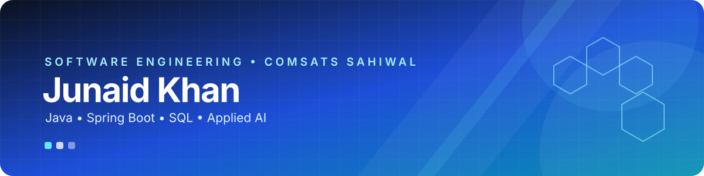

<!-- Animated profile header -->

  
  

---

## 👋 About Me

I'm **Junaid Khan**, a Software Engineering student at **COMSATS University, Sahiwal**, focused on building practical software and strengthening my foundations in backend development and AI.

- 💻 Working with **Java, OOP, data structures, SQL, and backend development**.
- ☕ Learning and building with **Spring Boot, JDBC, REST API concepts, and database integration**.
- 🤖 Exploring **AI and machine learning**, including Hugging Face model fine-tuning.
- 🧩 Interested in clean architecture, problem-solving, and projects that connect theory with real use cases.
- 🌱 Continuously learning by building, testing, and improving projects.

## 🛠️ Tech Stack

**Languages**

**Frameworks, Tools & Platforms**

  
  
  
  

## 🚀 Featured Projects

<table>
  <tr>
    <td width="50%" valign="top">
      <h3>🧠 AetherFT — AI Fine-Tuning Console</h3>
      
A web dashboard for managing Hugging Face language-model fine-tuning, datasets, training logs, inference experiments, and hardware telemetry.

      
<strong>Tech:</strong> Python, FastAPI, Transformers, PyTorch, Pandas, Chart.js

      <a href="https://github.com/junaidkhan051/Aether-FT-AI">View repository →</a>
    </td>
    <td width="50%" valign="top">
      <h3>🛡️ AI-Powered Insider Threat Detection</h3>
      
A security-focused dashboard concept for employee activity monitoring, behavioral analysis, threat alerts, and reporting.

      
<strong>Tech:</strong> HTML, CSS, JavaScript, AI/anomaly-detection concepts

      <a href="https://github.com/junaidkhan051/AI-Powered-Insider-Threat-Detection">View repository →</a>
    </td>
  </tr>
  <tr>
    <td width="50%" valign="top">
      <h3>🐞 Bug Tracker System</h3>
      
A Java OOP semester project for reporting, assigning, tracking, and resolving bugs, with data structures used for workflow and management.

      
<strong>Tech:</strong> Java, Swing, JDBC, SQL, MVC, DSA

      <a href="https://github.com/junaidkhan051/Semester-Project">View repository →</a>
    </td>
    <td width="50%" valign="top">
      <h3>📚 Library Management — Spring Boot</h3>
      
A backend learning project focused on library-management functionality and Java/Spring Boot development.

      
<strong>Tech:</strong> Java, Spring Boot, SQL

      <a href="https://github.com/junaidkhan051/Library-Management--Java-SpringBoot">View repository →</a>
    </td>
  </tr>
</table>

## 📊 GitHub Overview

  
  
   
  

## 🐍 Contribution Animation

  <picture>
    <source media="(prefers-color-scheme: dark)" srcset="https://raw.githubusercontent.com/junaidkhan051/junaidkhan051/output/github-contribution-grid-snake-dark.svg" />
    <source media="(prefers-color-scheme: light)" srcset="https://raw.githubusercontent.com/junaidkhan051/junaidkhan051/output/github-contribution-grid-snake.svg" />
    
  </picture>

## 🤝 Connect With Me

  
  

---

  
  
<em>Keep learning. Keep building. Keep improving.</em>

